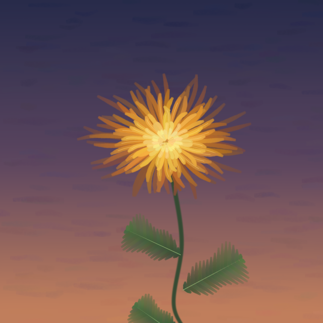
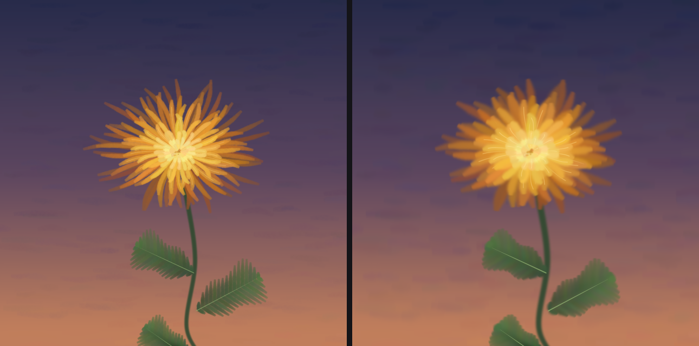
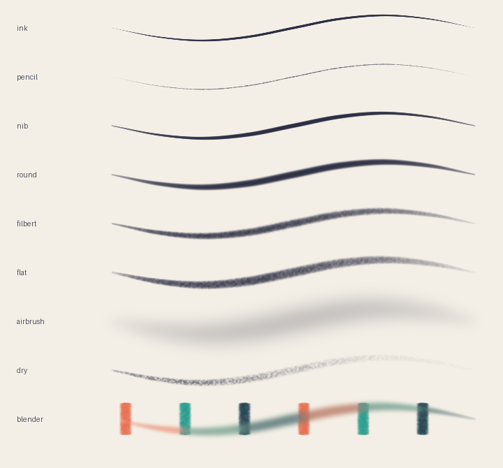

# paintcode

A small dab engine for painting from code. A stroke is a list of control points with pressure and tilt; the engine resamples it along its arc length and lays down a row of **anisotropic 2D Gaussians**. Every mark you see is made of splats.

It was written so a language model can paint with its own strokes: the model writes a compact JSON scene, the engine renders it deterministically, and the model looks at the PNG and decides the next strokes.



`examples/kiku.petal` holds its 629 strokes in 23 KB. Rendered, they become 52,731 dabs, which take 3.5 MB as a splat file. The strokes are the part that has to fit in a context window; the dabs never do.

## Install

```bash
pip install -e .            # numpy and pillow
pip install -e '.[dev]'     # plus pytest
uv sync                     # or: this package, the Rust core built as a Python module, and pytest
```

## Render

```bash
python -m paintcode scene.json -o out.png -o out.petal -o out.ply   # one render, three exports
python -m paintcode out.petal -o again.png                          # a project renders like a scene
python -m paintcode scene.json -o big.png --scale 2                 # coordinates and brush sizes scale together
python -m paintcode scene.json -o crisp.png --ss 3                  # supersample hard edges
python -m paintcode scene.json -o out.png --base old.png            # paint over an image (treated as dry paint)
```

| export | what it is |
|---|---|
| `.png` | the painting |
| `.petal` | the project: a ZIP (Deflate, lossless) with `scene.json`, `meta.json` and a small `preview.png`. It stores strokes, never dabs |
| `.ply` | every dab as a flat 3D Gaussian in the 3D Gaussian Splatting layout, readable by splat viewers |

The same scene and seed always produce the same pixels. Jitter is counter-based: every random number is a hash of (seed, stroke index, dab index, slot), so editing or lengthening one stroke never moves the jitter of another, and appending strokes leaves the ones before them alone. To keep working on a painting, append strokes to the scene and render it again rather than painting over the PNG: re-rendering keeps the wet-paint state that `--base` cannot recover.

Version 0.4 changed the random numbers (jitter and paper tooth), so a scene from 0.3 renders with slightly different jitter.

## Scene format

```json
{
  "canvas":  { "width": 640, "height": 640, "background": "#2a2f4a", "seed": 24 },
  "brushes": { "petal": { "preset": "filbert", "size": 8.5 } },
  "strokes": [
    { "brush": "petal", "color": [234, 164, 52],
      "points": [[330, 270, 0.3], [380, 240, 1.0], [420, 250, 0.45]] },
    { "brush": "ink", "color": "#e8d9b0", "size": 1.4, "flow": 0.3,
      "points": [[340, 268], [400, 246]] },
    { "brush": "blender", "color": null, "points": [[300, 300], [360, 300]] }
  ]
}
```

- **points** are `[x, y]`, `[x, y, pressure]` or `[x, y, pressure, tilt]`, with pressure and tilt in 0..1 (defaults 1 and 0). Coordinates are floats.
- **brush** is a preset name, a name from `brushes`, or an inline object `{"preset": ..., ...}`. Any brush field can also be overridden directly on the stroke.
- **color** is `[r, g, b]` (0..255) or `"#rrggbb"`. `null` loads the brush with whatever is under its first touch, which makes it a smudge.
- **smooth** (default `true`) runs a centripetal Catmull-Rom spline through the points; `false` keeps straight segments.

## The dab

Each dab is

$$\alpha(\mathbf{x}) = \text{flow}\cdot\exp\!\left(-\tfrac12\, q^{\,n}\right),\qquad n = \frac{1}{1-h},\qquad q = \left(\tfrac{u}{\sigma_x}\right)^2 + \left(\tfrac{v}{\sigma_y}\right)^2$$

where $(u, v)$ is the pixel offset rotated into the dab's frame and $h$ is hardness. The profile reaches $e^{-2}$ at $\sigma\, 2^{1/n}$, so the engine sets $\sigma = \text{radius}\cdot 2^{-1/n}$: the visible edge stays at the brush radius whatever the hardness, with $\sigma = r/2$ for a Gaussian and $\sigma = r$ for a hard ellipse. With $h = 0$ it is exactly a 2D Gaussian; as $h \to 1$ it becomes a hard-edged ellipse one sigma across. Sigmas below half a pixel are raised to 0.5 px, dabs are cut off at $q > 9$, and they are composited with plain "over". Dab geometry is computed in float64; the per-pixel kernel and the compositing are float32.

### Sharpness

A Gaussian is a low-pass filter, so a stroke made of Gaussians has soft edges by nature; hardness is the cure. A stroke of size 16 keeps a half-coverage width of 26 to 30 px from hardness 0 to 0.95, while its 10–90% edge narrows from about 14 px to 1 px. Hard brushes alias, so set `canvas.supersample` (or `--ss`) to paint at N times the size and box-filter down; the dabs and the jitter stay the same, only the sampling improves.

### As Gaussian splats

`.ply` writes one Gaussian per dab: position on the image plane (x right, y down, the longer side spanning $[-1, 1]$), scales $\log\sigma$ with a vanishing third axis, a quaternion for the dab angle about $z$, colour as the SH DC term, opacity as a logit. Paint order becomes depth: the first dab is farthest and the last is nearest to a camera on the $-z$ side, so depth-sorted splatting composites them in the order they were painted. The stack is only 0.05 deep, so this holds facing the plane: turned away, the splats sort by where they sit instead of when they were painted, and the wide early sky strokes drift in front of the flower. The files open in [SuperSplat](https://superspl.at/editor) through File > Import.

`paintcode.ply.render_splats` is a separate, plain rasteriser that reads only the PLY. For a painting made with hardness 0 and no grain it reproduces the PNG to within 2/255 (`test_ply_is_the_painting`). The 3DGS kernel has no hardness or grain, so other paintings come back softer:



## Brush fields

| field | meaning |
|---|---|
| `size` | visible radius in px at full pressure; the same size looks the same at every hardness |
| `aspect` | minor / major axis ratio |
| `angle` | `null`: the major axis lies across the stroke and turns with it; a number: fixed nib angle in degrees |
| `hardness` | profile exponent $1/(1-h)$: 0 is a Gaussian, 0.9 is nearly a hard ellipse |
| `flow` | opacity built up at the default spacing |
| `spacing` | dab distance as a fraction of the footprint; flow is normalised to it, so this only trades speed for smoothness |
| `min_size`, `size_gamma` | radius $= \text{size}\cdot\text{lerp}(\text{min\_size}, 1, p^{\gamma})$ |
| `min_flow`, `flow_gamma` | the same curve for flow |
| `tilt_stretch` | tilt 1 stretches the major axis by $1 + \text{tilt\_stretch}$ and thins the film |
| `size_jitter`, `angle_jitter`, `pos_jitter`, `flow_jitter` | uniform noise from the canvas seed |
| `load`, `half_life`, `min_load` | paint on the brush, and how many px of travel it takes to halve |
| `pickup` | share of the wet paint under the brush mixed into the carried colour, per radius of travel |
| `grain`, `grain_scale` | paper tooth fixed to the canvas, modulating every dab |

Presets: `ink`, `pencil`, `nib`, `round`, `filbert`, `flat`, `airbrush`, `dry`, `blender`.



### Wet paint

The canvas keeps a wetness map. Every dab makes the area under it wetter, and `pickup` only takes colour from wet paint, read from a snapshot taken when the stroke starts. So a brush never picks up the dry background, never re-picks its own trail, and the result does not depend on dab spacing.

## Python

```python
from paintcode import Canvas, get_brush, paint_stroke

c = Canvas(400, 200, background="#f4efe6", seed=1)
paint_stroke(c, get_brush("nib"), "#223", [[20, 100], [80, 140], [140, 90]])
paint_stroke(c, get_brush("filbert").with_(size=12), [200, 120, 40], [[20, 170, 0.3], [200, 165, 1], [380, 175, 0.2]])
c.save("out.png")
```

## Rust core

The same engine in Rust: one library, `crates/paintcode`, with one module per part of the engine, and the Python module built from it in `bindings/python`. Inside the library, dependencies point one way, from the leaf up; `tests/layering.rs` fails if a module reaches back down the list.

| module | part | may use | does |
|---|---|---|---|
| `math` | leaf | nothing | counter-based RNG, dab profile and geometry |
| `scene` | bones | math | scene, brush and stroke types, presets, colours |
| `render` | render | math | dabs to pixels, paper grain, downsampling |
| `stroke` | flesh | math, scene, render | control points to dabs, carrying paint |
| `io` | files | render | encoders and decoders, in pairs |

This package stays the reference. The core paints the same float32 arithmetic and is checked against it at 1e-5 on the float canvas; on `kiku.json` the largest difference is 2.4e-7.

A stroke is painted in two parallel phases: every dab's kernel and the wet paint under it are evaluated independently (pickup reads the canvas as it was when the stroke began, as the Python snapshot does), then the dabs are composited in order, one band of rows per thread. The fast path also skips the parts of each dab's square that lie outside its $q \le 9$ ellipse. None of this changes a bit: the tests render with the reference path (whole squares, `powf` everywhere, one thread) and require identical output.

`kiku.json`, 640², supersample 2, on a 2-core VM:

| engine | time |
|---|---|
| Python | 52 s |
| Rust, 1 thread | 7.0 s |
| Rust, 2 threads | 3.5 s |

```bash
uv sync                                                                # builds the core into .venv; rebuilds when any .rs changes
uv run python -c "import json, paintcode_core as c; open('k.png', 'wb').write(c.render_png(open('examples/kiku.json').read(), scale=2))"
cargo run --release --example bench -- examples/kiku.json            # time a render
```

## Tests

```bash
uv run pytest               # the engine, and the core against it
uv run pytest --slow        # also kiku.json through both engines (a minute)
cargo test --release -p paintcode   # the fast path against the reference path, and the module layering
```

They cover determinism, the pinned random numbers, jitter that stays put when another stroke changes, float32 pixel arithmetic, duplicate control points, stroke direction at joints, the pressure curves, the Gaussian profile, hardness, supersampling, spacing-independent pickup, dry backgrounds, smudging, and both export round trips.

## Credits

The ideas of paint depletion, colour pickup and short-stroke painting were learned from [paint-mcp](https://github.com/joeyballentine/paint-mcp). No code was taken from it.
